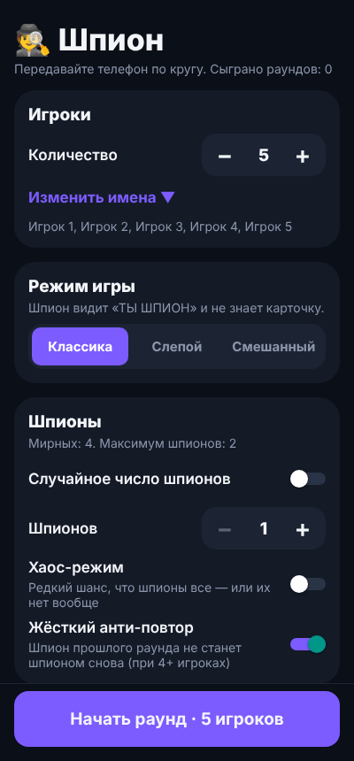
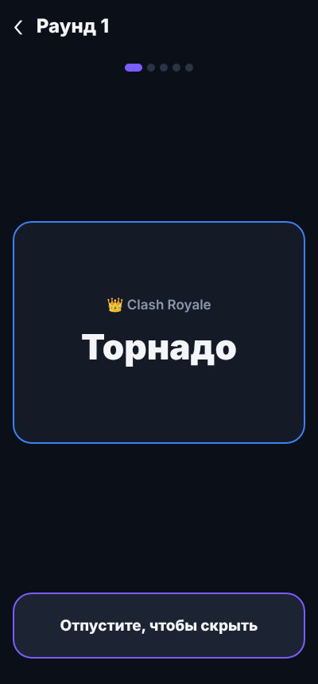
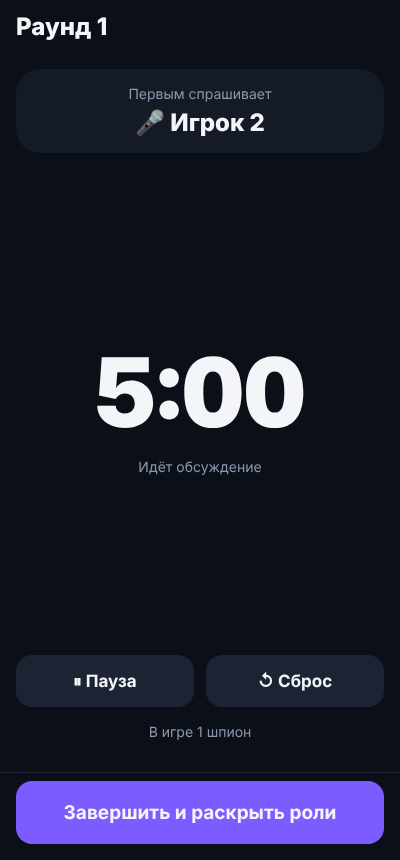

# 🕵️ Шпион — Pass & Play

Оффлайн-игра «Шпион» для компании на одном телефоне. Без регистрации, серверов, рекламы и подписок.

- **Режимы:** Классика · Слепой шпион (Undercover) · Смешанный
- **Честный рандом:** анти-серии для шпионов (pity-система), колода без повторов карточек, случайный первый игрок
- **Контент из коробки:** 412 карточек в 6 пулах, все размечены кластерами и парами для «Слепого шпиона»
- **Свои пулы:** быстрый ввод списком, пары `Слово 1 :: Слово 2`, импорт/экспорт кодом
- **Стек:** React Native 0.88 + Expo SDK 58 + TypeScript, AsyncStorage, expo-crypto

| Лобби | Карточка (удержание) | Раунд |
|---|---|---|
|  |  |  |

## Быстрый старт

Нужен Node.js 20+.

```bash
npm install
npm test            # 56 юнит-тестов (рандомайзер на 1000 раундов + контент)
npm run typecheck   # tsc --noEmit
npx expo start      # запустить; отсканируйте QR в Expo Go на Android/iOS
```

Все используемые нативные модули (AsyncStorage, Clipboard, Crypto, SafeArea) входят в Expo Go, поэтому для разработки dev-build не нужен.

## Сборка APK

### Вариант А — облачная сборка EAS (проще всего, без Android Studio)

```bash
npm install -g eas-cli      # или используйте npx eas-cli@latest
eas login                   # бесплатный аккаунт Expo
eas build -p android --profile preview
```

Профиль `preview` в `eas.json` собирает именно **.apk** (а не .aab). Через ~10–15 минут EAS даст ссылку на APK — откройте её на телефоне и установите.

### Вариант Б — локальная сборка

Нужны JDK 17 и Android SDK (проще всего поставить Android Studio и задать `ANDROID_HOME`).

```bash
npx expo prebuild -p android          # сгенерирует папку android/
cd android
./gradlew assembleRelease             # Windows: gradlew.bat assembleRelease
```

Готовый файл: `android/app/build/outputs/apk/release/app-release.apk`.
По умолчанию release подписан debug-ключом — для установки на свои устройства этого достаточно. Для Google Play создайте свой keystore ([инструкция Expo](https://docs.expo.dev/guides/local-app-production/)).

### iOS

`eas build -p ios` (нужен Apple Developer аккаунт) или `npx expo run:ios` на Mac с Xcode.

## Структура проекта

```
App.tsx                      — стек-навигатор + кнопка «Назад» Android
src/
  logic/
    randomizer.ts            — ВЕСЬ рандом: RNG, Фишер–Йетс, pity-веса, колоды, подбор близкой карты, planRound()
    types.ts                 — типы (Card, Pool, Settings, RoundPlan…)
    pools.ts                 — нормализация JSON-пулов
    customPools.ts           — свои пулы: парсер списка, импорт/экспорт, base64 UTF-8
  data/
    pools/*.json             — встроенные пулы
    index.ts
  state/GameContext.tsx      — состояние игры + сохранение в AsyncStorage
  screens/
    LobbyScreen.tsx          — настройка партии
    RevealScreen.tsx         — раздача ролей (удержание / тап)
    RoundScreen.tsx          — таймер, первый игрок
    ResultsScreen.tsx        — итоги, следующий раунд в 1 тап
    PoolsScreen.tsx          — список пулов
    PoolEditScreen.tsx       — конструктор своего пула
    PoolViewScreen.tsx       — встроенный пул: скрыть карточки, поделиться
    ImportScreen.tsx         — импорт по коду/JSON
  components/                — UI-кит и карточка роли
__tests__/
  randomizer.test.ts         — симуляции по 1000 раундов
  content.test.ts            — валидность пулов, импорт/экспорт
```

## Как устроен рандом (`src/logic/randomizer.ts`)

Модуль чистый: источник случайности передаётся параметром. В приложении — `expo-crypto.getRandomValues` (криптостойкий, буфер по 64 значения), в тестах — детерминированный `mulberry32`.

**1. Выбор шпионов (Anti-Streak / Pity).** Для каждого игрока хранится `roundsSinceLastSpy`.
Вес = `roundsSinceLastSpy ^ 1.5`. Шпион прошлого раунда (`= 0`) при N ≥ 4 получает вес `0`
(«жёсткий анти-повтор») или `0.05` (если его выключить); при N = 3 — `0.15`, иначе игра становится предсказуемой.
Несколько шпионов — взвешенная выборка без возвращения. Число шпионов ограничено `floor((N−1)/2)`, чтобы мирных всегда было больше.
Хаос-раунды («все шпионы» / «никого») не сдвигают баланс.

**2. Колода без повторов.** Каждый пул — перетасованная Фишером–Йетсом колода с указателем, сохранённая в AsyncStorage. При нескольких пулах категория выбирается с весом «сколько в ней осталось карт» — это равномерный выбор из всех ещё не сыгранных карт. Колоды тасуются заново только когда сыграно всё, и новая колода не начинается с последней сыгранной карты. Добавленные/скрытые карты подмешиваются/убираются без сброса истории (`syncDeck`).

**3. Близкая карта для «Слепого шпиона».** `similarIds` (в обе стороны) → тот же кластер → любая карта пула. Карта шпиона никогда не совпадает с картой мирных (проверяется и по id, и по названию). Если в пуле одна карта, слепой шпион становится классическим.

**4. Первый игрок.** Та же pity-логика по `roundsSinceFirst`: не повторяется подряд и равномерно распределён.

Тесты проверяют на 1000 раундах: отсутствие серий, равномерность (±12%), отсутствие повторов карточек до исчерпания колоды (для каждого пула и для смеси), корректность карты слепого шпиона во всех пулах, смешанный режим, хаос.

## Встроенные пулы

| Пул | Карточек | Кластеров |
|---|---|---|
| 👑 Clash Royale | 105 | 17 |
| 🎮 Популярные игры (Brawl Stars, CS2, Minecraft, Dota 2, GTA…) | 83 | 12 |
| 🎥 Блогеры и стримеры (RU + Global) | 61 | 11 |
| 🎬 Кино, сериалы и аниме | 59 | 7 |
| 📍 Классика: места и профессии | 56 | 7 |
| 🐸 Мемы и интернет | 48 | 6 |

Формат JSON (`src/data/pools/*.json`):

```json
{
  "id": "clash_royale", "name": "Clash Royale", "icon": "👑", "color": "#3B82F6",
  "clusters": [
    { "id": "heavy_tanks", "label": "Тяжёлые танки", "tags": ["Войско"],
      "cards": [ { "name": "Мегарыцарь", "similar": ["П.Е.К.К.А."] }, "Голем" ] }
  ]
}
```

`similar` ссылается на названия карточек того же пула. Чтобы добавить пул, положите JSON в `src/data/pools/` и подключите в `src/data/index.ts` — тесты сами проверят размер, уникальность и ссылки.

## Свои пулы

«📚 Мои пулы» → «＋ Создать». В поле быстрого ввода — по слову в строке:

```
Шаурма
Кола :: Пепси          ← пара: слепой шпион получит второе слово
Самса | выпечка        ← кластер
```

«Поделиться» копирует код `SPY1:…` (или JSON), «Импорт» принимает и то и другое. Встроенный пул тоже можно скопировать кодом и импортировать как свой, чтобы править.
